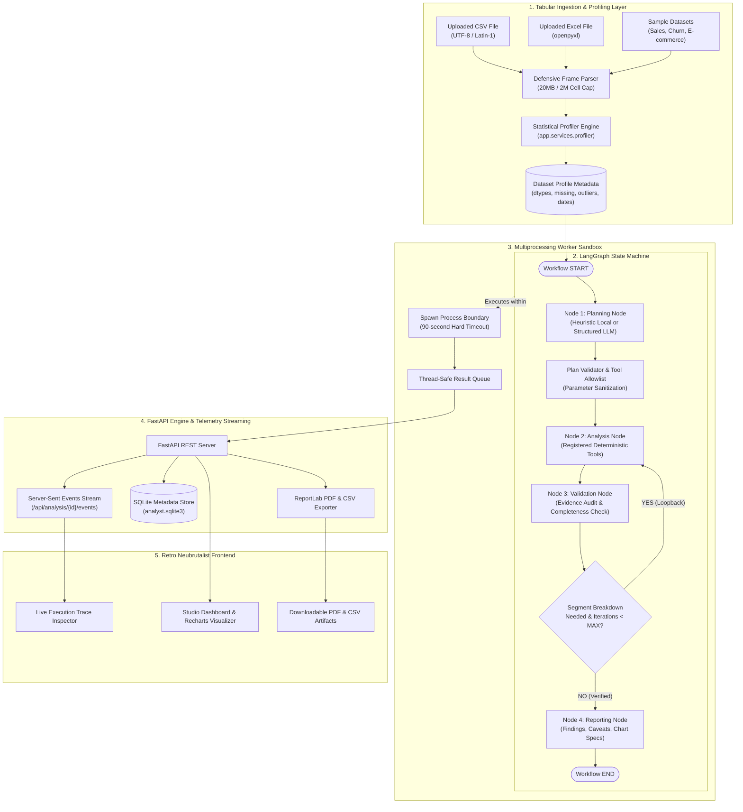
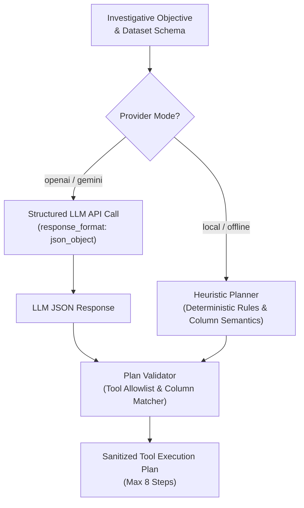
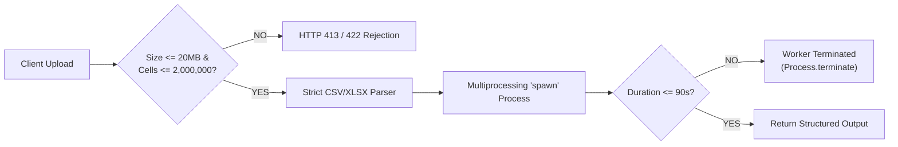
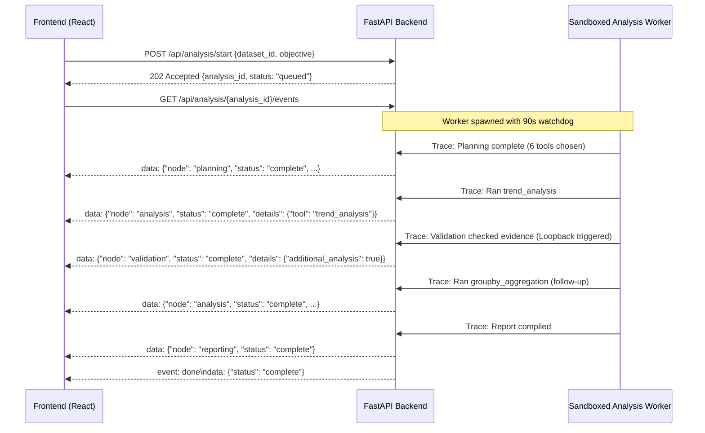

# System Architecture & Technical Specifications

This document provides a comprehensive technical breakdown of the architectural decisions, state-machine mechanics, deterministic tool execution engine, validation routing, and security boundaries powering the **Autonomous Data Analyst Agent**.

---

## 1. High-Level System Architecture



---

## 2. LangGraph Stateful Orchestration

Unlike conversational chatbot loops that output unstructured prose, the Autonomous Data Analyst Agent executes a compiled directed state graph implemented with **LangGraph** (`langgraph.graph.StateGraph`).

### Shared State Model (`AnalystState`)
Every node in the execution graph reads from and writes to a strongly typed dictionary:

```python
class AnalystState(TypedDict, total=False):
    dataframe: pd.DataFrame           # Cleaned pandas DataFrame in memory
    objective: str                     # User-defined investigative goal
    provider: str                      # 'local', 'openai', 'gemini', or 'auto'
    api_key: str | None                # Ephemeral key (zeroized post-planning)
    profile: dict[str, Any]            # Statistical summary from profiler
    plan: dict[str, Any]               # Validated sequence of tool invocations
    results: list[dict[str, Any]]      # Exact tool outputs and metrics
    findings: list[dict[str, Any]]     # Derived factual conclusions
    trace: list[dict[str, Any]]        # Audit log of node actions
    iteration: int                     # Active loopback counter
    max_iterations: int                # Hard boundary (default: 3)
    validation: dict[str, Any]         # Validation verdict and checklist
    report: dict[str, Any]             # Final aggregated report structure
    error: str                         # Error message if failure occurs
```

### The 4 Specialized Nodes


#### 1. `planning_node`
- Evaluates the user's natural language objective against the statistical profile of the dataset.
- Decides whether to invoke the offline heuristic planner or request a structured JSON plan from OpenAI / Gemini.
- Immediately passes the generated plan through `_validate_plan()` to strip unauthorized tools, non-existent columns, or malicious parameters.
- Clears the transient `api_key` immediately after plan generation so credentials never persist in state.

#### 2. `analysis_node`
- Iterates over scheduled steps in the validated plan.
- Dispatches execution to `run_tool()` in `app.services.tools`.
- Captures computed metrics, records execution timestamps into `trace`, and derives preliminary findings via `_derive_findings()`.
- Catches per-tool exceptions safely without halting the entire graph, logging a warning event in the trace.

#### 3. `validation_node`
- Audits the evidence base: verifies that tools produced concrete computed results and that all claims map directly to registered tools.
- Evaluates analytical completeness:
  - If a time-series trend was discovered (`trend_analysis`) and categorical dimensions exist in the data, but no segment breakdown was performed, the validator flags `needs_more_analysis = True`.
  - The conditional edge `route_after_validation` routes the execution back to `analysis_node` for an automated follow-up pass.
  - Guarded by `max_iterations = 3` to strictly prevent infinite looping.

#### 4. `reporting_node`
- Synthesizes findings, data quality notes, tool receipts, and limitations into a consolidated, schema-compliant JSON payload.
- Generates chart configurations tailored for Recharts rendering (Line charts for time-series, Bar charts for segment breakdowns and histograms).
- Appends standard epistemic caveats (e.g., *"Correlation does not imply causation"*, *"Findings reflect the uploaded sample and chosen statistical bounds"*).

---

## 3. Dual Planning Architecture

The system provides complete analytical autonomy even when disconnected from external AI APIs:



### 1. Heuristic Local Planner (Offline & Deterministic)
- Inspects column names using semantic keyword buckets (`NUMERIC_HINTS`, `DATE_HINTS`, `GROUP_HINTS`).
- Automatically schedules foundational data hygiene tools: `dataset_summary`, `missing_analysis`, and `duplicate_check`.
- Detects intent keywords in user objectives (e.g., `"why"`, `"growth"`, `"decline"`, `"trend"`) to trigger `trend_analysis` and `segment_change_analysis`.
- Computes pairwise Pearson correlation matrices when multiple numerical fields exist.
- Employs IQR outlier scans on the primary metric.

### 2. LLM-Assisted Planner (OpenAI & Gemini)
- Sends **only** the schema profile (row count, column names, pandas dtypes, date fields) — **never table cells or raw data**.
- Enforces strict JSON response formatting (`response_format={"type": "json_object"}`).
- The system prompt forbids claiming computed results in advance:
  > *"You are a careful data analyst planner. Do not claim to have computed anything."*

### 3. Strict Parameter Allowlist & Sanitization
Every plan (local or LLM-generated) is sanitized:
```python
def _validate_plan(plan: dict[str, Any], profile: dict[str, Any]) -> dict[str, Any]:
    valid = []
    for step in plan.get("steps", []):
        if step.get("tool") not in TOOL_DESCRIPTIONS:
            continue
        params = {k: v for k, v in step.get("params", {}).items() 
                  if v in profile["column_names"] and k in {"column", "target", "metric", "group_by", "date_column"}}
        valid.append({"tool": step["tool"], "label": step.get("label")[:80], "params": params})
    return {"steps": valid[:8], ...}
```

---

## 4. Deterministic Analysis Tool Registry

The agent **cannot execute arbitrary Python scripts, shell commands, or raw SQL queries**. Every calculation is performed by deterministic functions in `app/services/tools.py`:

| Tool Identifier | Mathematical / Statistical Methodology | Safe Column Verification |
| :--- | :--- | :--- |
| `dataset_summary` | Matrix shape inspection, dtypes profiling | Validates dataframe presence |
| `missing_analysis` | Per-column null vector counts (`df.isna().sum()`) | Global dataset scan |
| `duplicate_check` | Full-row tuple hashing (`df.duplicated().sum()`) | Global dataset scan |
| `correlation_analysis` | Pearson correlation matrix with pair ranking | Checks $\ge 2$ numeric columns |
| `groupby_aggregation` | Grouped `sum`, `mean`, and `count` aggregations | Verifies `group_by` and numeric `metric` |
| `segment_change_analysis` | Equal-length temporal window split at midpoint; segment delta calculation ($\Delta = T_2 - T_1$) | Verifies datetime field, numeric metric, categorical group |
| `trend_analysis` | Month-end (`ME`) resampling with aggregated totals and averages | Verifies datetime field and numeric metric |
| `outlier_detection` | Tukey's 1.5 $\times$ IQR rule ($[Q_1 - 1.5 \cdot \text{IQR},\, Q_3 + 1.5 \cdot \text{IQR}]$) | Verifies numeric field |
| `distribution_analysis` | Automatic Sturges/Freedman-Diaconis binning histogram for numeric; top-12 value counts for categorical | Dynamic type branching |
| `feature_relationships` | Spearman rank correlation & non-linear scikit-learn `mutual_info_regression` | Verifies target and continuous predictors |
| `statistical_analysis` | Five-number summary + mean, std, count via `df.describe()` | Scans all numeric fields |

---

## 5. Security & Isolation Framework



### Defensive Upload Constraints
- **Size Cap**: Hard 20 MB limit enforced at HTTP stream reading level (`await file.read(MAX_UPLOAD_BYTES + 1)`).
- **Cell Count Cap**: Max 2,000,000 cells ($rows \times columns$) to prevent memory exhaustion and quadratic algorithmic blowups.
- **File Type Whitelist**: Accepts only `.csv` (with UTF-8 and Latin-1 fallbacks) and `.xlsx` via `openpyxl`.
- **Header Sanitization**: Column names are stripped of whitespace and guaranteed unique to eliminate injection vectors.

### Multiprocessing Child Sandbox
Tabular computations run in a dedicated subprocess initialized via `multiprocessing.get_context("spawn")`:
- **Timeout Protection**: The child process is joined with a hard 90-second deadline (`ANALYSIS_TIMEOUT_SECONDS = 90`). If exceeded, `process.terminate()` is called immediately.
- **Process Isolation**: Any memory leak, native library segmentation fault, or heavy Pandas operation cannot crash the primary FastAPI application server.
- **Zero Raw Data Transmission**: External LLMs receive zero data records, preserving privacy and compliance (GDPR/HIPAA).
- **Ephemeral Storage**: Uploaded files in the system temporary directory are purged automatically upon process termination via Python's `atexit` hook.

---

## 6. Real-Time Telemetry & Event Streaming

The backend provides continuous transparency into the agent's analytical progress via Server-Sent Events (SSE) at `/api/analysis/{analysis_id}/events`:



---

## 7. Presentation & Design Architecture

The user interface follows a **Retro Neubrutalism** aesthetic designed for clarity and legibility:
- **Design Tokens**: Warm paper canvas (`#f4f1ea`), bold 2px black borders (`#171717`), high-contrast hard drop shadows (`3px 3px 0 #171717`), and distinct functional accent colors:
  - Acid Yellow (`#d8fa57`): Highlights and key findings
  - Tomato Coral (`#ff6b42`): Warnings and prominent action buttons
  - Royal Indigo (`#6554e8`): Structural icons and technical badges
- **Dual Visualizer**: Dynamic line charts for temporal sequences and grouped bar charts for categorical metrics using **Recharts**.
- **Auditability First**: Every finding card directly displays supporting metrics and includes a toggleable "Inspect tool results" drawer exposing raw JSON receipts for peer review.
