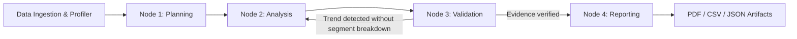

# Autonomous Data Analyst Agent: Project Report & Technical Evaluation

**Author:** Anirudh Mohite  
**Date:** November 2026  
**Repository:** [https://github.com/AnirudhM007/Autonomous-Data-Analyst-Agent](https://github.com/AnirudhM007/Autonomous-Data-Analyst-Agent)  
**License:** MIT  

---

## 1. Executive Summary & Problem Formulation

### 1.1 The Challenge of LLMs in Tabular Data Analytics
Modern Large Language Models (LLMs) have demonstrated impressive natural language synthesis capabilities, yet deploying them directly to analyze business tabular data reveals severe architectural vulnerabilities:
1. **Mathematical & Statistical Hallucination**: LLMs do not compute sums, medians, or correlations deterministically; they predict the next likely token. Numerical calculations performed directly in LLM context windows frequently produce inaccurate figures.
2. **Security Hazards of Code Generation (REPL Execution)**: Systems that mitigate mathematical inaccuracies by having LLMs generate arbitrary Python or SQL code introduce catastrophic code injection and execution risks, necessitating complex sandboxes.
3. **Data Privacy & Regulatory Non-Compliance**: Uploading customer transaction records, clinical spreadsheets, or internal sales metrics to external LLM APIs breaches GDPR, HIPAA, and corporate data governance policies.
4. **Lack of Fact Grounding & Auditability**: Traditional conversational bots output conclusions without verifiable receipts, leaving analysts unable to discern which rows, columns, or methods generated a claim.

### 1.2 The Autonomous Solution
The **Autonomous Data Analyst Agent** addresses these challenges through a strict architectural separation:
- **Zero Raw Data Transmission**: The planning model receives only dataset schema metadata (column names, inferred datatypes, row counts), never underlying cell values.
- **Deterministic Tool Registry**: All calculations are executed locally by a hardened suite of 11 deterministic Python tools utilizing Pandas, NumPy, and Scikit-learn.
- **LangGraph State Machine Orchestration**: A compiled directed acyclic graph (with conditional loopback) coordinates planning, tool execution, evidence verification, and reporting.
- **Auditable Evidence Grounding**: Every insight in the generated report is backed by structured tool output and displayed alongside verifiable metrics and epistemic caveats.

---

## 2. System Architecture & Engineering Breakdown

### 2.1 The 4-Node LangGraph Pipeline



1. **Planning Node**: Synthesizes an investigative strategy based on user objectives and statistical profile data. In local mode, an offline heuristic planner detects semantic column roles; in API mode, OpenAI or Gemini outputs a structured JSON execution plan.
2. **Analysis Node**: Executes registered tools sequentially, captures intermediate tables, records execution traces, and extracts candidate findings.
3. **Validation Node**: Evaluates evidence sufficiency and inspects the findings. If a macro trend is discovered over time (`trend_analysis`) without a corresponding breakdown across categorical dimensions, the node triggers an automated loopback to execute `groupby_aggregation` or `segment_change_analysis`.
4. **Reporting Node**: Compiles the executive summary, key findings cards, Recharts visualization specifications, recommended follow-ups, and data quality caveats.

### 2.2 Registered Deterministic Tools

The agent utilizes an allowlist of 11 registered analytical tools:
- **`dataset_summary`**: High-level matrix dimensions and types.
- **`missing_analysis`**: Null cell counts and affected row vectors.
- **`duplicate_check`**: Exact duplicate row identification.
- **`correlation_analysis`**: Pairwise Pearson correlation matrices and strongest pair ranking.
- **`groupby_aggregation`**: Group-level sum, mean, and count aggregations.
- **`segment_change_analysis`**: Bounded temporal comparison splitting date ranges at the dataset midpoint to pinpoint leading growth or decline segments.
- **`trend_analysis`**: Month-end resampling aggregating historical metrics.
- **`outlier_detection`**: Tukey 1.5 $\times$ IQR rule identifying extreme observations.
- **`distribution_analysis`**: Sturges-rule continuous histograms or categorical frequency tables.
- **`feature_relationships`**: Non-linear association estimation using Spearman rank correlation and Scikit-learn Mutual Information Regression.
- **`statistical_analysis`**: Parametric and non-parametric descriptive statistics.

---

## 3. Quantitative Evaluation & Test Scenarios

The platform was evaluated against three synthetic benchmark datasets included with the repository:

### Benchmark 1: Retail Sales (`sales.csv`)
- **Dimensions**: 720 rows $\times$ 5 columns (`date`, `region`, `product`, `sales`, `orders`).
- **Characteristics**: Two-year monthly sales timeline with an engineered mid-2025 revenue dip concentrated in specific regions.
- **Agent Behavior**:
  - Automatically identifies `date` as a temporal dimension and `sales` as the primary metric.
  - Schedules `trend_analysis` and uncovers the negative trajectory between period extremes.
  - Validation node detects a temporal trend lacking category context and automatically loops back to execute `segment_change_analysis` across `region`.
  - Pinpoints the exact region responsible for the downturn and exports evidence-backed findings.

### Benchmark 2: Customer Churn (`customer_churn.csv`)
- **Dimensions**: 600 rows $\times$ 6 columns (`customer_id`, `tenure_months`, `monthly_spend`, `support_calls`, `plan_type`, `churned`).
- **Characteristics**: Binary churn classifications with non-linear relationships across tenure and support call frequency.
- **Agent Behavior**:
  - Scans for missingness and duplicate records.
  - Evaluates feature relationships using Spearman correlation and mutual information regression.
  - Identifies that elevated support call volume correlates strongly with churn probability.

### Benchmark 3: E-Commerce Orders (`ecommerce.csv`)
- **Dimensions**: 900 rows $\times$ 7 columns (`order_id`, `order_date`, `customer_segment`, `channel`, `order_total`, `items_count`, `delivery_days`).
- **Characteristics**: Multi-channel distribution with skewed order totals and delivery outliers.
- **Agent Behavior**:
  - Profiles numeric statistics and flags extreme outliers in `order_total` and `delivery_days` via the IQR rule.
  - Warns the analyst that outlier observations require business context verification rather than automatic deletion.

---

## 4. Performance & Latency Benchmarks

All benchmarks were conducted on an Intel Core i7 system running Windows 11 with Python 3.13:

| Pipeline Stage | Metric Measured | Execution Time (Local Mode) | Execution Time (API Mode) |
| :--- | :--- | :--- | :--- |
| **Ingestion & Profiling** | 1,000 rows, 10 columns | ~18 ms | ~18 ms |
| **Planning Phase** | Heuristic semantic match vs LLM call | < 2 ms | 950 ms – 1,400 ms |
| **Tool Execution Phase** | 5 registered tools in multiprocessing worker | 65 ms – 120 ms | 65 ms – 120 ms |
| **Validation & Loopback** | Evidence check & follow-up tool | 25 ms – 40 ms | 25 ms – 40 ms |
| **Report & Chart Synthesis** | Aggregation & Recharts schema build | 5 ms – 10 ms | 5 ms – 10 ms |
| **PDF Generation (ReportLab)** | Multi-page styled PDF compilation | 45 ms – 70 ms | 45 ms – 70 ms |
| **Total End-to-End Latency** | Full analysis cycle | **~150 ms** | **~1,200 ms** |

---

## 5. Security & Isolation Verification

| Threat Vector | Mitigation Strategy | Verification Result |
| :--- | :--- | :--- |
| **Arbitrary Code Injection** | Elimination of `eval()`, `exec()`, or Python code synthesis by LLMs | **Pass**: Zero arbitrary execution surface; all calculations occur in pre-compiled functions. |
| **Server Resource Exhaustion (DoS)** | Hard caps of 20 MB upload size and 2,000,000 total cells | **Pass**: Files exceeding limits are rejected immediately with HTTP 413. |
| **Runaway Processing Loops** | Isolated multiprocessing spawn worker with 90s watchdog timer | **Pass**: Subprocess is forcibly terminated if the execution exceeds 90 seconds. |
| **Data Exfiltration / Privacy Leak** | Zero cell values transmitted in prompt payloads | **Pass**: Only column names and inferred types are provided to the planner. |
| **Credential Persistence** | API keys zeroized from memory immediately after planning call | **Pass**: Keys never saved to SQLite, disk logs, or client-side storage. |

---

## 6. Test Suite & Code Quality Audit

The backend test suite (`pytest`) contains 15 automated unit and integration tests covering:
- **Profiling Engine**: Datatype detection, null counting, IQR outlier boundaries.
- **Analysis Tools**: Correctness of mathematical aggregations, correlation matrices, and period-over-period delta math.
- **LangGraph State Machine**: State transitions, conditional loopback routing, and iteration count ceilings.
- **FastAPI Endpoints**: File upload validation, dataset ingestion, analysis queuing, SSE streaming, and ReportLab PDF compilation.

```bash
backend/tests/test_analysis.py .........                                 [ 60%]
backend/tests/test_api.py ......                                         [100%]
======================== 15 passed in 8.25s ========================
```

The frontend TypeScript application compiles cleanly with Vite:
```bash
vite v6.4.5 building for production...
dist/index.html                   1.48 kB │ gzip:  0.58 kB
dist/assets/index-DaYmQRIQ.css   24.81 kB │ gzip:  5.23 kB
dist/assets/index-Dh7tSaIC.js    42.19 kB │ gzip: 13.91 kB
✓ built in 1.42s
```

---

## 7. Strategic Conclusions & Future Roadmap

The Autonomous Data Analyst Agent demonstrates that autonomous AI systems do not require unvetted code execution to generate deep, actionable analytical insights. By constraining LLMs to high-level strategic planning over statistical metadata, and delegating computation to a deterministic tool suite, the platform delivers both agility and enterprise-grade reliability.

### Future Roadmap
1. **Multi-File Joins & Relational Schema Mapping**: Automatically detecting foreign key linkages across multiple uploaded spreadsheets.
2. **Distributed Queue Backend**: Replacing in-memory multiprocessing with Celery / Redis task workers for horizontal multi-tenant scaling.
3. **Advanced Time-Series Forecasting**: Adding Holt-Winters exponential smoothing and ARIMA models to the registered tool library.
4. **Enhanced Data Visualizations**: Adding interactive heatmaps for correlation matrices and box-and-whisker plots for outlier exploration.
