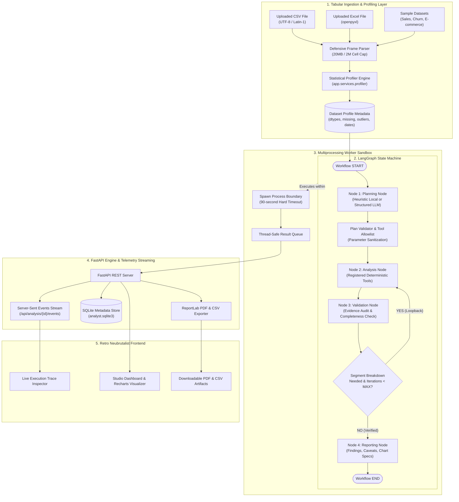

# 📊 Autonomous Data Analyst Agent

[](https://github.com/AnirudhM007/Autonomous-Data-Analyst-Agent/actions)
[](https://www.python.org/)
[](https://fastapi.tiangolo.com/)
[](https://langchain-ai.github.io/langgraph/)
[](https://pandas.pydata.org/)
[](https://scikit-learn.org/)
[](https://react.dev/)
[](https://www.typescriptlang.org/)
[](https://tailwindcss.com/)
[](https://opensource.org/licenses/MIT)

> **Autonomous Data Analyst Agent** is a portfolio-grade, full-stack tabular data analysis workbench powered by a stateful **LangGraph** workflow, an isolated deterministic tool registry, a local-first offline planner, and a **Retro Neubrutalist** analyst console.

Upload any CSV or Excel file, ask a business question, and watch the agent autonomously profile the schema, synthesize a multi-step analytical plan, run deterministic statistical tools, validate evidence grounding with automated loopbacks, and compile an executive report with interactive Recharts visualizers, PDF export, and raw tool output receipts.

---

## 🏛️ System Architecture



---

## ⚡ Key Architectural Features

- **Zero Raw Data to Remote APIs**: External planners (OpenAI / Gemini) only receive dataset metadata (column names, types, row count), preserving confidentiality and data governance. No cell data ever leaves your machine.
- **No Arbitrary Code Execution**: Eliminates the catastrophic vulnerabilities of LLM Python code generation (`eval()`, `exec()`, or shell commands). All computations occur inside a hardened suite of registered tools.
- **Multiprocessing Worker Process Sandbox**: Analysis executions run inside an isolated `spawn` subprocess with a hard 90-second execution deadline.
- **Automated Validation Loopback**: When a macro time trend is detected without segment context, the LangGraph validation router automatically initiates a second analysis pass to segment the change.
- **Dual Planning Modes**:
  - **Local Heuristic Mode (Free & Offline)**: Semantic column inference and rule-based planning with zero external API dependencies.
  - **LLM-Assisted Mode**: Structured JSON plan generation via OpenAI (`gpt-4o-mini`) or Google Gemini (`gemini-3.8-flash`).
- **Real-Time SSE Streaming**: Live trace events stream directly to the browser over Server-Sent Events (`/api/analysis/{id}/events`).
- **Multi-Format Report Export**: Download executive summaries and findings as professional formatted **PDFs** (via `ReportLab`) or structured **CSVs**.
- **Retro Neubrutalist Interface**: High-contrast warm paper surface, bold ink borders, crisp offset shadows, Recharts data visualizers, and raw tool output inspection.

---

## 🔬 Deterministic Analysis Tool Registry

The agent executes calculations exclusively through registered Python functions in `backend/app/services/tools.py`:

| Tool Identifier | Analytical Methodology | Primary Purpose |
| :--- | :--- | :--- |
| `dataset_summary` | Matrix shape inspection & dtypes enumeration | Establish dimensions and field coverage |
| `missing_analysis` | Null value aggregation (`df.isna().sum()`) | Quantify completeness and flag data gaps |
| `duplicate_check` | Exact row hashing (`df.duplicated().sum()`) | Detect repeated entries that could bias totals |
| `correlation_analysis` | Pearson pairwise correlation matrix | Identify linear relationships between numeric measures |
| `groupby_aggregation` | Group-level `sum`, `mean`, and `count` | Segment primary metrics across categories |
| `segment_change_analysis` | Equal-length temporal window split at midpoint | Locate the exact category with the largest shift |
| `trend_analysis` | Month-end (`ME`) resampling aggregation | Track metric trajectories over chronological periods |
| `outlier_detection` | Tukey's 1.5 $\times$ IQR rule | Flag extreme values without automatic deletion |
| `distribution_analysis` | Dynamic Sturges histogram / frequency counts | Describe skewness and spread across continuous or discrete fields |
| `feature_relationships` | Spearman correlation & Mutual Information | Capture non-linear associations with continuous targets |
| `statistical_analysis` | Parametric and non-parametric five-number stats | Compute mean, median, standard deviation, and quartiles |

---

## 🚀 Quick Start (Docker)

Run both the FastAPI backend and React frontend with a single command:

```bash
docker compose up --build
```

- **Frontend Application**: Open [http://localhost:5173](http://localhost:5173)
- **FastAPI Documentation**: Open [http://localhost:8000/docs](http://localhost:8000/docs)

---

## 💻 Manual Local Setup

### Prerequisites
- **Python 3.11+**
- **Node.js 20+** and **npm**

### 1. Backend Setup
```bash
cd backend
python -m venv .venv

# On Linux/macOS:
source .venv/bin/activate

# On Windows PowerShell:
.\.venv\Scripts\Activate.ps1

pip install -r requirements.txt
cp .env.example .env
uvicorn app.main:app --reload --port 8000
```
Interactive OpenAPI documentation is available at [http://localhost:8000/docs](http://localhost:8000/docs).

### 2. Frontend Setup
In a second terminal:
```bash
cd frontend
npm install
npm run dev
```
Open [http://localhost:5173](http://localhost:5173) in your browser.

---

## 📁 Project Structure

```text
autonomous-data-analyst-agent/
├── .github/
│   └── workflows/
│       └── ci.yml                # Automated GitHub Actions test & build pipeline
├── backend/
│   ├── app/
│   │   ├── agent/
│   │   │   └── workflow.py       # LangGraph state machine, planner, router, and report compiler
│   │   ├── services/
│   │   │   ├── profiler.py       # Fast statistical dataset profiler engine
│   │   │   └── tools.py          # 11 registered, sandboxed analysis tools
│   │   ├── samples/              # Built-in synthetic datasets (Sales, Churn, E-commerce)
│   │   └── main.py               # FastAPI REST endpoints, SSE stream, and PDF exporter
│   ├── tests/
│   │   ├── test_analysis.py      # Profiler and tool unit tests
│   │   └── test_api.py           # End-to-end FastAPI endpoint tests
│   ├── Dockerfile                # Backend container definition
│   ├── pytest.ini                # Pytest configuration and path resolution
│   └── requirements.txt          # Python dependencies
├── frontend/
│   ├── src/
│   │   ├── App.tsx               # Neubrutalist analyst dashboard and interactive workspace
│   │   ├── main.tsx              # Application entrypoint
│   │   └── styles.css            # Retro neubrutalist visual styling and tokens
│   ├── Dockerfile                # Multi-stage production container build
│   ├── nginx.conf                # Nginx reverse proxy configuration
│   ├── package.json              # Node dependencies and scripts
│   ├── tailwind.config.js        # Design tokens and scanning rules
│   └── vite.config.ts            # Vite bundler configuration
├── ARCHITECTURE.md               # In-depth architectural & state-machine specifications
├── CONTRIBUTING.md               # Contribution workflow and PR checklist
├── docker-compose.yml            # Multi-container orchestration
├── LICENSE                       # MIT License
├── PROJECT_REPORT.md             # Comprehensive evaluation report and performance benchmarks
├── push_to_github.bat            # One-click GitHub synchronization script
└── README.md                     # Project documentation
```

---

## 🧪 Testing & Verification

Run the comprehensive 15-test backend test suite:
```bash
cd backend
python -m pytest tests -v
```

Run the frontend TypeScript typecheck and production build:
```bash
cd frontend
npm run build
```

---

## 🌐 REST API Reference

| Method | Endpoint | Description |
| :--- | :--- | :--- |
| `GET` | `/api/health` | Service health status and active planner mode |
| `GET` | `/api/datasets/examples` | Returns catalog of built-in sample datasets |
| `POST` | `/api/datasets/upload` | Upload a user CSV/XLSX file (20 MB / 2M cell limit) |
| `POST` | `/api/datasets/examples/{id}` | Ingests one of the built-in sample datasets |
| `GET` | `/api/datasets/{id}` | Returns metadata for an ingested dataset |
| `GET` | `/api/datasets/{id}/profile` | Returns the detailed statistical profile of a dataset |
| `POST` | `/api/analysis/start` | Dispatches an asynchronous LangGraph execution job |
| `GET` | `/api/analysis/{id}` | Returns run status, error information, and final report |
| `GET` | `/api/analysis/{id}/trace` | Returns chronological execution trace events |
| `GET` | `/api/analysis/{id}/events` | **Server-Sent Events (SSE)** real-time stream |
| `GET` | `/api/analysis/{id}/report` | Formats: `json` (default), `csv`, or `pdf` |

---

## 🛡️ Security & Privacy Boundaries

- **Strict Tabular Boundaries**: Uploads are restricted to 20 MB and 2,000,000 cells.
- **Multiprocessing Worker Sandbox**: Each analysis runs in an isolated child process with a hard 90-second timeout.
- **Epistemic Honesty**: All findings explicitly state that associations do not prove causation.
- **Ephemeral Storage**: Uploaded files in temporary system storage are automatically cleaned up on process exit.
- **Key Safety**: User-entered API keys are held transiently in memory for that single planning invocation, never written to SQLite, logs, or local storage.

---

## 📄 License

This project is licensed under the **MIT License** — see the [LICENSE](LICENSE) file for details.
